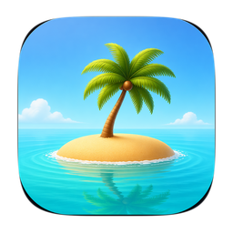

<h1 align="center">
  <br>
  
  <br>
  Islet
  <br>
</h1>

<p align="center">
  刘海之上的一座小岛 —— MacBook 刘海工具箱
</p>

---

**Islet**（小岛屿）让你的 MacBook 刘海不再闲着。悬停上去，刘海会展开成一个小岛：音乐控制、日历提醒、文件暂存架，还有一整套本地工具箱。所有数据处理都在本机完成，不上传任何东西。

本项目基于 [boring.notch](https://github.com/TheBoredTeam/boring.notch)（GPL-3.0）二次开发，在原有 Home 和 Shelf 之外新增了**工具箱（Toolbox）**。

## ✨ 工具箱

| 标签页 | 功能 |
| --- | --- |
| 📸 截图 | 区域截图（⌘⇧X）、窗口截图、全屏截图（ScreenCaptureKit）；原生标注编辑器（画笔 / 矩形 / 箭头 / 文字）；复制与保存；贴图置顶悬浮窗（Snipaste 风格）；Apple Vision 本地 OCR |
| 🌐 翻译 | Apple 端侧翻译（macOS 15+）：输入翻译、图片文字翻译（截图 → OCR → 翻译）、跨应用划词翻译（⌃⌥Y） |
| 📋 剪贴板 | Maccy 风格历史记录：文本 / 链接 / 图片，类型筛选、搜索、收藏，点击条目即可粘贴回之前活跃的应用 |

加上原有的能力：音乐播放控制与可视化、日历与提醒事项集成、文件暂存架（支持隔空投送）、系统 HUD 替换（音量 / 亮度 / 键盘背光）、镜像自拍、充电指示等。

## 🔐 权限说明

- **屏幕录制**：截图与 OCR 需要
- **辅助功能**：划词翻译、剪贴板粘贴回目标应用需要
- **剪贴板历史**默认关闭，可在剪贴板标签页中开启

## 📦 安装

**系统要求：** macOS 14 Sonoma 或更高版本，Apple Silicon / Intel 均可。

从 Releases 下载 `.dmg`，把 **Islet** 拖进 `/Applications`。因为没有 Apple 开发者签名，首次打开会提示「无法验证开发者」，在终端执行一次即可：

```bash
xattr -dr com.apple.quarantine "/Applications/Islet.app"
```

或者在 **系统设置 → 隐私与安全性** 底部点「仍要打开」。

## 🛠 从源码构建

**环境要求：** macOS 15.6+，Xcode 26+

```bash
git clone <本仓库地址>
cd boring.notch
open boringNotch.xcodeproj
```

在 Xcode 中按 `Cmd + R` 运行。

工具箱相关代码位于 `boringNotch/components/Toolbox/`。

## 🙏 致谢

- **[boring.notch](https://github.com/TheBoredTeam/boring.notch)** – 上游项目，GPL-3.0
- **[MediaRemoteAdapter](https://github.com/ungive/mediaremote-adapter)** – macOS 15.4+ 的 Now Playing 数据源
- **[NotchDrop](https://github.com/Lakr233/NotchDrop)** – Shelf 功能的灵感来源

完整第三方许可列表见 [THIRD_PARTY_LICENSES](./THIRD_PARTY_LICENSES)。
